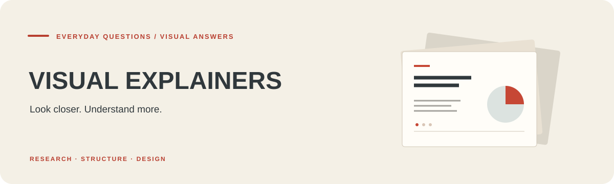
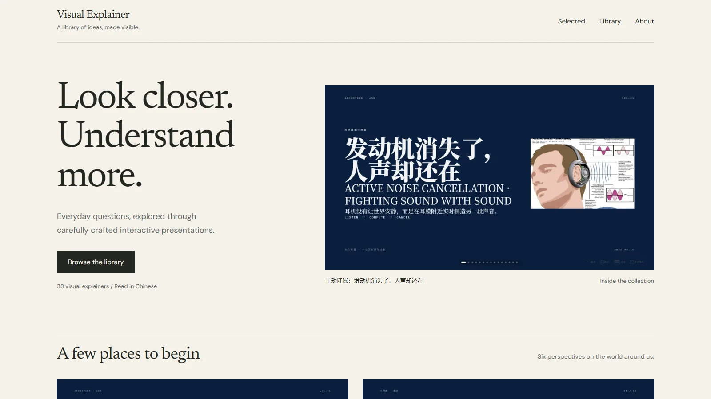
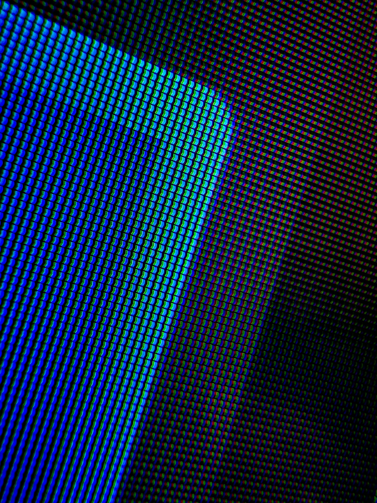
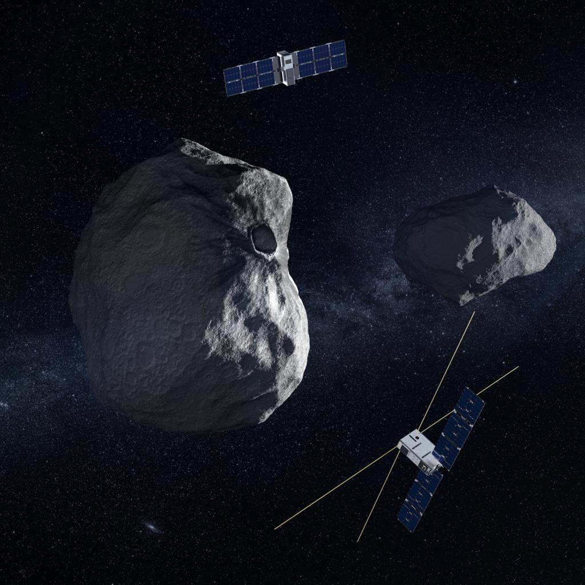

<p align="center">
  
</p>

<h1 align="center">📐 Visual Explainer PPTs</h1>

<p align="center">
  <strong><a href="https://seiya058904.github.io/Visual-Explainer-PPTs/">🌐 Open the Live PPT Collection →</a></strong>
  <br />
  <a href="https://seiya058904.github.io/Visual-Explainer-PPTs/">seiya058904.github.io/Visual-Explainer-PPTs</a>
</p>

<p align="center">
  <strong>One question. A clearer way to see it.</strong>
</p>

<p align="center">
  A collection of browser-native visual explainers about science, technology,<br>
  engineering, everyday phenomena, and the systems behind them.
</p>

<p align="center">
  <a href="ppt-collection/">📚 Approved Decks</a>
  &nbsp;·&nbsp;
  <a href="#visual-language">🎨 Visual Language</a>
  &nbsp;·&nbsp;
  <a href="#making-an-explainer">🛠️ How They're Made</a>
</p>

<p align="center">
  <sub>48 APPROVED HTML DECKS &nbsp; · &nbsp; TWO EDITORIAL SYSTEMS &nbsp; · &nbsp; ONE PRODUCTION STANDARD</sub>
</p>

<p align="center">
  <a href="https://seiya058904.github.io/Visual-Explainer-PPTs/">
    
  </a>
  <br />
  <sub>The library, captured in a real browser. Every cover opens an interactive HTML presentation.</sub>
</p>

---

> **A good explainer doesn't just present information. It changes what you understand.**
>
> Every deck begins with a question worth answering. Evidence, visual structure, typography, and motion work together to make the explanation easier to follow—not merely more decorative.

<a id="featured-explainers"></a>
## 🔎 Featured Explainers

Choose a question and follow the argument. These are selected **approved standalone HTML decks** from [`ppt-collection/`](ppt-collection/), rather than a list of every working folder.

The gallery selects six starting points from the same [catalog](site/catalog.json) that drives the full library below. Each preview is captured from the real presentation.

<p align="center">
  <strong><a href="https://seiya058904.github.io/Visual-Explainer-PPTs/">Browse all 48 interactive explainers →</a></strong>
</p>

> [!TIP]
> **Want to view a deck?** Visit the [interactive library](https://seiya058904.github.io/Visual-Explainer-PPTs/) to search, filter and open every approved work. For a local copy, download its raw HTML file and open it in a browser. The approved exports are designed as standalone HTML files; optional network fonts or enhancements may still require a connection. Deck content is primarily authored in Chinese, while this repository guide is in English.

## 🖼️ A Few Visual Studies

Every topic calls for a different kind of explanation. These examples are **actual image assets from the source decks**, not screenshots of the full presentations.

<table>
  <tr>
    <td width="50%" align="center" valign="top">
      <a href="ppt-collection/display-how-images-are-made.html">
        
      </a>
      <br />
      <strong><a href="ppt-collection/display-how-images-are-made.html">Inside a Display →</a></strong>
      <br />
      <sub>Pixels, color, and the creation of an image</sub>
    </td>
    <td width="50%" align="center" valign="top">
      <a href="ppt-collection/planetary-defense-changing-the-odds.html">
        
      </a>
      <br />
      <strong><a href="ppt-collection/planetary-defense-changing-the-odds.html">Planetary Defense →</a></strong>
      <br />
      <sub>Detection, intervention, and changing a trajectory</sub>
    </td>
  </tr>
</table>

<a id="visual-language"></a>
## 🎨 One Framework. Two Visual Languages.

Every presentation is produced under **`guizang-ppt-skill`**, with consistent rules for narrative structure, typography, layouts, motion, and quality assurance. The subject changes; the production discipline does not.

<table>
  <tr>
    <td width="50%" valign="top">
      <h3>📰 Style A — Editorial Magazine</h3>
      <p><sub>EDITORIAL · E-INK · STORY-LED</sub></p>
      <p>Expressive typography and carefully paced layouts for subjects that benefit from narrative, context, comparison, and visual explanation.</p>
      <p><strong>Often suited to:</strong> everyday science, culture, history, and human-centered stories.</p>
    </td>
    <td width="50%" valign="top">
      <h3>▦ Style B — Swiss International</h3>
      <p><sub>GRID · HIERARCHY · PRECISION</sub></p>
      <p>Restrained compositions built around alignment, whitespace, legibility, and a fixed set of structured layouts.</p>
      <p><strong>Often suited to:</strong> engineering, data, technical systems, and analytical subjects.</p>
    </td>
  </tr>
</table>

Neither is a license to trade accuracy for appearance. Strong visual contrast and meaningful motion support the underlying explanation; they must never obscure facts, labels, or sources.

<a id="making-an-explainer"></a>
## 🛠️ From Question to Finished Deck

**Research → Write → Structure → Design → Verify → Approve**

1. **Start with the real question.** Define what the viewer should understand, and find evidence that can support it.
2. **Build the narrative.** Each slide should introduce a useful fact, explain a mechanism, establish a comparison, or change the viewer's understanding.
3. **Choose the visual system.** Apply the established Style A / Style B layouts, typography, color palettes, and page schema—not a new template for every deck.
4. **Use motion with intent.** Transitions and staged reveals should help explain relationships. The static or reduced-motion state must remain readable.
5. **Check in a real browser.** Review legibility, layout, overflow, navigation, and motion at the repository's required viewport sizes, including smaller effective screens.
6. **Promote only approved work.** A working topic folder is not automatically a released deck. After explicit approval, export and preserve its self-contained HTML in [`ppt-collection/`](ppt-collection/).

> [!IMPORTANT]
> **An exported HTML file is a deliverable, not the source of truth for future editing.** Working folders retain the source and materials. Approved standalone files are created through the repository's controlled export process.

## 🗂️ Repository Guide

```text
YYYY-MM-DD-topic-name/   Source projects, decks, and topic-specific assets
ppt-collection/          Approved standalone HTML presentations
docs/                    Drafts, build tools, audits, and process records
5.9/                     Historical/failed experiments — not design references
AGENTS.md                Production rules, motion constraints, and acceptance
Writing guide (original source filename)   Writing and research guide
```

The two normative entry points are the [production and QA rules](AGENTS.md) and the [writing guide](PPT%20%E9%AB%98%E8%B4%A8%E9%87%8F%E6%96%87%E6%A1%88%E7%94%9F%E6%88%90%20Prompt%EF%BD%9C%E7%B2%BE%E7%AE%80%E4%BC%98%E5%8C%96%E7%89%88.md). The writing guide governs research, narrative, factual discipline, and source quality; `AGENTS.md` governs the project's visual system, implementation, browser acceptance, and delivery lifecycle.

<details>
<summary><strong>⚙️ Maintainer notes — export and verification</strong></summary>

The repository includes a controlled exporter and browser QA tooling under [`docs/build/`](docs/build/). To check an individual source file's local dependencies before exporting:

```bash
python docs/build/export-standalone.py 2026-08-30-soap-translating-oil/index.html --check-only
```

For exporter regression tests:

```bash
python -m unittest discover -s docs/build -p 'test_*.py'
```

The export tool inlines supported local images and the bundled motion engine into a standalone file. Check the resulting deck in a real browser; successful export alone does not prove its slides, transitions, readability, or navigation are correct. See [`AGENTS.md`](AGENTS.md) for required visual QA and approval rules.

Do not treat [`5.9/`](5.9/) as a template or quality baseline. It contains retained historical or failed experiments.

</details>

## 📜 Rights and Attribution

This repository has **no declared project-wide open-source license**. Public source access and an HTML download do not, by themselves, authorize reuse, modification, or redistribution of every deck or its media. Check any third-party asset's rights and source separately.

---

<p align="center">
  <sub>Everyday questions. Carefully structured answers. Visual understanding.</sub><br>
  <sub>Made to explain—not just to decorate.</sub>
</p>

## Browse the complete library

The new static gallery can be built locally with `npm ci` and `npm run build`. See [gallery maintenance](docs/maintenance/gallery-maintenance.md) for preview, verification and publication status.

<!-- catalog:start -->
- [How Noise Cancelling Headphones Make Silence](ppt-collection/active-noise-cancellation-fighting-sound-with-sound.html) — 主动降噪：发动机消失了，人声却还在
- [How AI Is Changing Everyday Life](ppt-collection/ai-and-life.html) — AI是如何影响我们生活的
- [How AI Is Reshaping Modern Life](ppt-collection/ai-impact-on-modern-life.html) — AI如何影响现代人类生活
- [How AI Learns the Atmosphere](ppt-collection/ai-weather-learning-the-atmosphere.html) — AI 天气预报：天气预报开始不再只靠方程
- [The Engineering Inside an Airplane](ppt-collection/airplane.html) — 飞机
- [Bill Gates: Curiosity, Code, and Influence](ppt-collection/bill-gates-biography.html) — 比尔·盖茨：把好奇心写进时代的人
- [Canned Food and the Making of Modern Life](ppt-collection/canned-civilization.html) — 罐头：把季节封存在金属里
- [The Invisible World of Semiconductors](ppt-collection/chips.html) — 芯片：现代科技背后的隐形心脏
- [How Clocks Made Time a Shared System](ppt-collection/clocks.html) — 钟表：人类如何把时间变成制度
- [The Cold Chain Behind Modern Food](ppt-collection/cold-chain.html) — 冷链：现代食物背后的低温文明
- [Concrete: The Liquid Skeleton of Modern Life](ppt-collection/concrete-liquid-skeleton.html) — 混凝土：流动的母体
- [How Trust Became Credit](ppt-collection/credit.html) — 信用
- [How Screens Build an Image](ppt-collection/display-how-images-are-made.html) — 显示屏：画面其实不存在
- [The Bottleneck Behind the Electric Grid](ppt-collection/electric-grid-bottleneck.html) — 电网：电力时代看不见的瓶颈
- [The Elevator: A Machine That Reshaped the City](ppt-collection/elevator.html) — 电梯：让城市向天空生长 · Elevator Civilization
- [The Glass Nerves of the Internet](ppt-collection/fiber-optics-glass-nervous-system.html) — 光纤：在玻璃微丝中奔跑的文明
- [GLP-1: Beyond Weight Loss](ppt-collection/glp-1-beyond-weight-loss.html) — GLP-1 减肥药：减肥药为什么改变了医学
- [How Insurance Makes Risk Shareable](ppt-collection/insurance.html) — 保险：人类如何给不确定性定价 · Insurance
- [Jensen Huang and the Long Game of Computing](ppt-collection/jensen-huang.html) — 黄仁勋：把计算重新点燃的人
- [Keys, Locks, and the History of Security](ppt-collection/keys-and-locks.html) — 钥匙与锁：安全感的技术史
- [Lithium Batteries and a Cordless World](ppt-collection/lithium-battery-tetherless-world.html) — 锂电池：被驯服的移动能量密度
- [Modern Medicine and Human Longevity](ppt-collection/medical-longevity.html) — 现代医学：让生命拥有更多时间
- [How Microbes Shape Chocolate](ppt-collection/microbial-chocolate-designing-flavour.html) — 巧克力发酵：它还不是巧克力
- [Where the Microwave Heat Comes From](ppt-collection/microwave-where-heat-comes-from.html) — 微波炉：饭热了，盘子呢？
- [How Navigation Changed the Way We Find Our Way](ppt-collection/navigation.html) — 导航
- [The Industrial Miracle Behind a Pill](ppt-collection/pills-industrial-miracle.html) — 药片
- [Planetary Defense: Changing the Odds](ppt-collection/planetary-defense-changing-the-odds.html) — 小行星防御：它只需要 20 米
- [Inside the Black and White Squares of a QR Code](ppt-collection/qr-code-inside-the-black-white-squares.html) — 二维码：为什么缺一块还能扫？
- [Why Queues Can Feel Fair](ppt-collection/queueing.html) — 排队：现代社会最安静的公平机制
- [The Science of Where Garbage Goes](ppt-collection/science-of-garbage.html) — 垃圾：我们扔掉的东西，并没有离开世界
- [The Screw: A Small Standard That Holds the World](ppt-collection/screws.html) — 螺丝
- [SPF 50: What the Sunscreen Number Means](ppt-collection/spf-50-decoding-sunscreen.html) — 防晒指数：SPF 50 不是 50 倍时间
- [The Art and System of Cinema](ppt-collection/the-art-of-cinema.html) — 电影的艺术：把时间制造成梦
- [The Tire: Where the Car Meets the World](ppt-collection/tires.html) — 轮胎
- [Twenty Years That Recompiled the World](ppt-collection/twenty-years.html) — 科技二十年：世界被重新编译
- [How Weather Forecasts Work](ppt-collection/weather-forecast.html) — 天气预报：人类如何预测明天 · Weather Forecast
- [Wi-Fi: The Last Few Meters of Connection](ppt-collection/wifi.html) — Wi-Fi：空气中的互联网秩序
- [Why the World Stops for Football](ppt-collection/world-cup.html) — 足球：世界为什么为一颗球停下
- [Air Conditioning Moves Heat](ppt-collection/air-conditioning-moving-heat.html) — 空调：冷下来靠搬走热量
- [Why Bridges Are Always Moving](ppt-collection/bridges-always-moving.html) — 桥梁：它从来不是静止的
- [How Caffeine Blocks Sleepiness](ppt-collection/caffeine-blocking-sleepiness.html) — 咖啡因：它没有给你任何能量
- [The Shipping Container That Changed Trade](ppt-collection/container-the-box.html) — 集装箱：改变世界的不是船
- [Fingerprints Were Not Made for Grip](ppt-collection/fingerprints-not-for-grip.html) — 指纹：皮肤上最著名的误解
- [Why Glass Is Transparent and Solid](ppt-collection/glass-transparent-solid.html) — 玻璃：一场能量的错身而过
- [How Soap Carries Oil Away](ppt-collection/soap-translating-oil.html) — 肥皂：一块皂里的分子工程
- [The Engineering Behind Tap Water](ppt-collection/tap-water-clean-process.html) — 自来水：拧开龙头后的百年工程
- [The Physics of the Yellow Light](ppt-collection/traffic-light-yellow-physics.html) — 黄灯：三秒钟的物理题
- [The Engineering in a Zipper](ppt-collection/zipper-line-of-teeth.html) — 拉链：一行可以开合的牙齿
<!-- catalog:end -->

## Maintenance and review evidence

The [48-work audit](docs/maintenance/iteration-2026-10-28.md) links individual review cards and records factual changes, tested artifacts and remaining limits. On October 29, the owner approved all ten former candidates; all 48 works now belong to the formal collection. The dated audit retains its original review scope. See [maintenance instructions](docs/maintenance/gallery-maintenance.md) for reproducible exports, covers, checks and local candidate previews.

Core text and embedded images were checked with external networking blocked. Three historical decks still use online photographs: Bill Gates (9), Medical Longevity (1), and Science of Garbage (2). Their gallery entries disclose this limitation.
