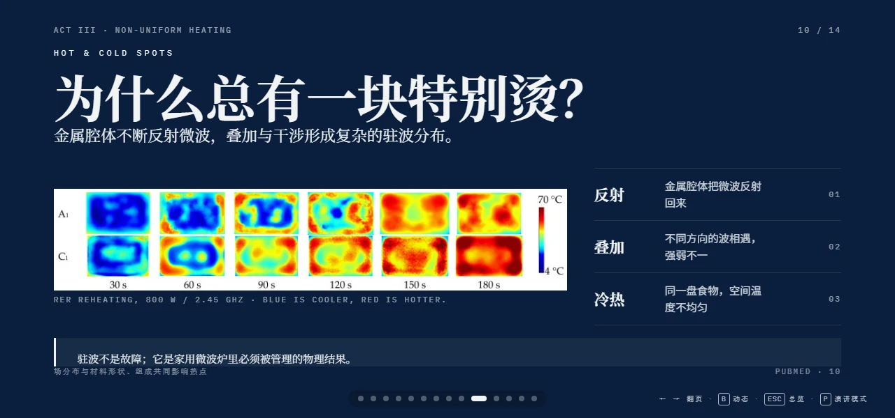
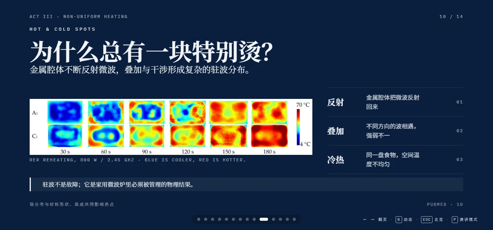
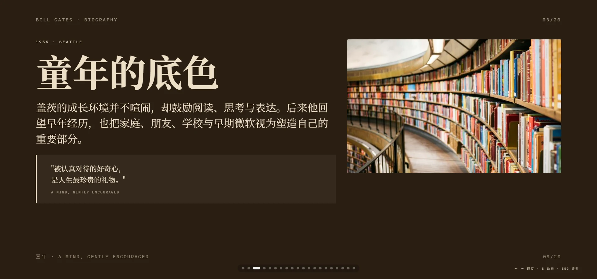
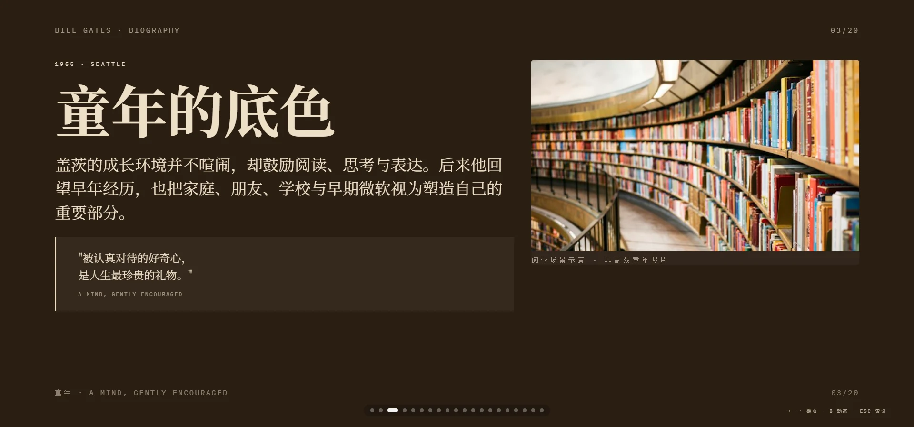

# Approved decks: wide/short viewport layout repair

Following the user-reported Pending bottom clipping, all **38 Approved / 569 pages** were checked for the same defect. **30 decks received source-level layout repairs; 8 passed this layout review without changes.** Approved status and original public paths are retained. The ten Pending decks remain unchanged and unpromoted.

## Cause and repair

- In 24 decks, viewport-width font sizing and oversized frame minima could consume the space reserved for lower content. Existing font scales now also respect available height, while preserving pixel readability floors and each deck's theme.
- Bill Gates, medical longevity and garbage photos previously filled their whole figure before the caption was laid out. A dedicated caption row keeps attribution visible after the real online image loads.
- Targeted source/footer clearance and dense-page spacing were adjusted only where measurements found problems. AI and Life P7, Cinema P7 and Microwave P10 required specific card/callout spacing repairs.
- Visible HTML text-node sequences are unchanged in all 30 sources. No scientific claims, presenter runtime or animation engine were changed. All artifacts were regenerated with the existing exporter and match the browser-tested candidate bytes.

## Actual verification

| Gate | Result |
|---|---|
| Changed-deck dynamic Chromium | 457 pages × 4 viewports = 1,828 page-viewports, no recorded overflow/footer/nav overlap, invisible text, broken images, console/page errors or failed requests |
| Unchanged-deck dynamic Chromium | 112 pages × 2 wide/short viewports = 224 page-viewports; no recorded failures |
| Final full-library static text geometry | 569 pages × 2 = 1,138 page-viewports; zero ancestor clipping, viewport clipping or footer-clearance failures |
| Export identity | 30/30 fresh exports match tested candidate SHA-256; exact per-deck paths/hashes in the ledger |
| Offline core reading | Matching-byte passes for all 30 changed decks; 8 unchanged decks retain their previously verified matching-byte evidence |
| Catalog and filters | 48 records, zero catalog errors; 2 filter/catalog unit tests passed |
| Gallery under project prefix | 5 viewports, all 38 links, search/categories, open/back, no-JS, reduced-motion and 404 recovery passed; `.codex/approved-bottom/gallery-qa/results.json` |

Dynamic viewports for changed decks: 1600×900, 1280×720, 1000×560 and 1920×900. Unchanged-deck dynamic and full-library static checks: 1920×900 and 1280×600. Static checks enter the existing low-power mode and assert the real page index before measuring all text nodes, including clipping ancestors and the footer. Decorative `.ghost` background words are excluded; reading content is not excluded.

Visual inspection: 74 problem-page screenshots from the other 28 changed decks were reviewed as contact sheets; full-size before/after captures were inspected for Gates P3, AI and Life P7, elevator P1, microwave P10, cinema P7, QR P7 and ANC P6. Contact sheets assess composition and are not evidence of small-text legibility by themselves. The existing first-round three-viewport visual review remains documented in each card.

Early footer runs identified two residual 1280×600 issues (Microwave P10 and Cinema P7); both were corrected and rechecked. A local HTTP server later returned empty responses, interrupting one full regression and one dynamic deck. Those failed/incomplete runs are retained as diagnostics and are not counted as passes. The final full-library run used a fresh server on port 8911.

## Reproduce

```powershell
# Start a local repository server with output redirected to files.
$env:DECK_BASE='http://127.0.0.1:8911'
node docs/build/test-approved-layout.mjs .codex/approved-layout
# Optional DECK_STAGE points to a candidate folder; DECK_IDS selects comma-separated Approved IDs.

node docs/build/browser-qa.mjs --mode approved --base http://127.0.0.1:8911 --manifest <changed-artifact-paths.txt> --out <qa-dir> --viewports 1600x900,1280x720,1000x560,1920x900 --concurrency 6
python docs/build/export-standalone.py <source> --output-name <id>.html --stage <staging-dir> --out-dir ppt-collection
node docs/build/test-offline.mjs --manifest <artifact-paths.txt> --out <offline-dir> --concurrency 4
python docs/build/audit-catalog.py
npm test
```

Final raw evidence is under `.codex/approved-bottom/`; [the tracked ledger](approved-bottom-ledger.json) selects the exact successful per-deck reports and hashes, including the final two-deck rerun. Large raw reports/screenshots are local process artifacts.

## Per-work result

The page column below lists the pages that triggered a repair, not a claim that shared responsive CSS affects only those pages. All pages of every changed deck were rechecked.

| Work | Pages | Repair-trigger pages | Layout result |
|---|---:|---|---|
| [主动降噪：发动机消失了，人声却还在](reviews/active-noise-cancellation-fighting-sound-with-sound.md) | 15 | 2, 6 | 已修复；四档动态全页通过 |
| [AI是如何影响我们生活的](reviews/ai-and-life.md) | 10 | 6, 7, 10 | 已修复；四档动态全页通过 |
| [AI如何影响现代人类生活](reviews/ai-impact-on-modern-life.md) | 10 | 1 | 已修复；四档动态全页通过 |
| [AI 天气预报：天气预报开始不再只靠方程](reviews/ai-weather-learning-the-atmosphere.md) | 13 | 2, 6, 8, 11, 13 | 已修复；四档动态全页通过 |
| [飞机](reviews/airplane.md) | 20 | — | 本项审查通过，无需改动 |
| [比尔·盖茨：把好奇心写进时代的人](reviews/bill-gates-biography.md) | 20 | 3, 4, 8, 9, 11, 14, 16, 18 | 已修复；四档动态全页通过 |
| [罐头：把季节封存在金属里](reviews/canned-civilization.md) | 15 | 9 | 已修复；四档动态全页通过 |
| [芯片：现代科技背后的隐形心脏](reviews/chips.md) | 24 | 10, 21 | 已修复；四档动态全页通过 |
| [钟表：人类如何把时间变成制度](reviews/clocks.md) | 10 | 3, 10 | 已修复；四档动态全页通过 |
| [冷链：现代食物背后的低温文明](reviews/cold-chain.md) | 10 | — | 本项审查通过，无需改动 |
| [混凝土：流动的母体](reviews/concrete-liquid-skeleton.md) | 15 | 2, 15 | 已修复；四档动态全页通过 |
| [信用](reviews/credit.md) | 20 | 3 | 已修复；四档动态全页通过 |
| [显示屏：画面其实不存在](reviews/display-how-images-are-made.md) | 15 | — | 本项审查通过，无需改动 |
| [电网：电力时代看不见的瓶颈](reviews/electric-grid-bottleneck.md) | 13 | 3, 4, 8 | 已修复；四档动态全页通过 |
| [电梯：让城市向天空生长 · Elevator Civilization](reviews/elevator.md) | 10 | 1, 10 | 已修复；四档动态全页通过 |
| [光纤：在玻璃微丝中奔跑的文明](reviews/fiber-optics-glass-nervous-system.md) | 10 | 3, 4, 6, 8, 9 | 已修复；四档动态全页通过 |
| [GLP-1 减肥药：减肥药为什么改变了医学](reviews/glp-1-beyond-weight-loss.md) | 13 | — | 本项审查通过，无需改动 |
| [保险：人类如何给不确定性定价 · Insurance](reviews/insurance.md) | 15 | 9, 10, 11 | 已修复；四档动态全页通过 |
| [黄仁勋：把计算重新点燃的人](reviews/jensen-huang.md) | 20 | 2, 4, 6, 13, 15, 16 | 已修复；四档动态全页通过 |
| [钥匙与锁：安全感的技术史](reviews/keys-and-locks.md) | 20 | 2 | 已修复；四档动态全页通过 |
| [锂电池：被驯服的移动能量密度](reviews/lithium-battery-tetherless-world.md) | 10 | 5 | 已修复；四档动态全页通过 |
| [现代医学：让生命拥有更多时间](reviews/medical-longevity.md) | 10 | 9 | 已修复；四档动态全页通过 |
| [巧克力发酵：它还不是巧克力](reviews/microbial-chocolate-designing-flavour.md) | 13 | 5, 6, 9 | 已修复；四档动态全页通过 |
| [微波炉：饭热了，盘子呢？](reviews/microwave-where-heat-comes-from.md) | 14 | 10 | 已修复；四档动态全页通过 |
| [导航](reviews/navigation.md) | 20 | 10, 13, 19 | 已修复；四档动态全页通过 |
| [药片](reviews/pills-industrial-miracle.md) | 28 | 3 | 已修复；四档动态全页通过 |
| [小行星防御：它只需要 20 米](reviews/planetary-defense-changing-the-odds.md) | 13 | 13 | 已修复；四档动态全页通过 |
| [二维码：为什么缺一块还能扫？](reviews/qr-code-inside-the-black-white-squares.md) | 14 | 2, 7 | 已修复；四档动态全页通过 |
| [排队：现代社会最安静的公平机制](reviews/queueing.md) | 10 | 2, 3, 5, 7, 8, 9 | 已修复；四档动态全页通过 |
| [垃圾：我们扔掉的东西，并没有离开世界](reviews/science-of-garbage.md) | 15 | 6, 7, 8, 9, 12 | 已修复；四档动态全页通过 |
| [螺丝](reviews/screws.md) | 20 | 5 | 已修复；四档动态全页通过 |
| [防晒指数：SPF 50 不是 50 倍时间](reviews/spf-50-decoding-sunscreen.md) | 14 | — | 本项审查通过，无需改动 |
| [电影的艺术：把时间制造成梦](reviews/the-art-of-cinema.md) | 15 | 7 | 已修复；四档动态全页通过 |
| [轮胎](reviews/tires.md) | 15 | — | 本项审查通过，无需改动 |
| [科技二十年：世界被重新编译](reviews/twenty-years.md) | 10 | — | 本项审查通过，无需改动 |
| [天气预报：人类如何预测明天 · Weather Forecast](reviews/weather-forecast.md) | 15 | 11 | 已修复；四档动态全页通过 |
| [Wi-Fi：空气中的互联网秩序](reviews/wifi.md) | 15 | — | 本项审查通过，无需改动 |
| [足球：世界为什么为一颗球停下](reviews/world-cup.md) | 20 | 1, 2 | 已修复；四档动态全页通过 |

## Before / after

Microwave P10 at 1280×600:





Bill Gates P3 at 1920×900:





## Limits

This follow-up concerns desktop direct-reading layout in the measured windows, not every zoom ratio or portrait mobile deck layout. Twelve external photo placements (Gates 9, medical 1, garbage 2) still require a network connection; offline core readability is not complete offline visual equivalence. Existing factual/media limitations remain in the individual reviews. Presenter schema/synchronization validators were not rerun for this CSS-only follow-up; no runtime code changed, and the first-round results remain historical evidence.
